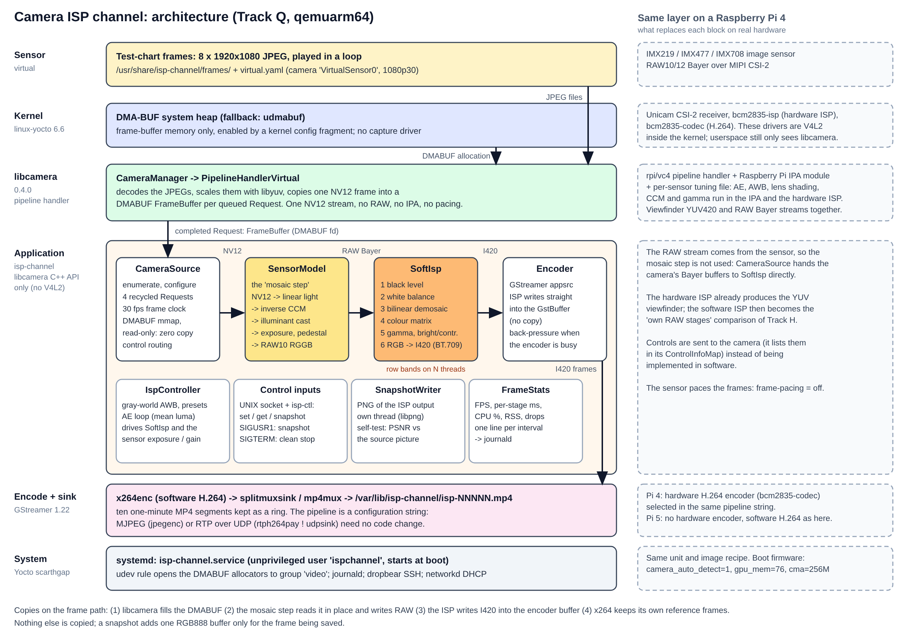

# Camera ISP Channel on Yocto (Track Q, QEMU)

A Yocto image that boots in QEMU and runs a complete camera ISP channel at
start-up:

```
virtual sensor -> libcamera -> RAW Bayer -> software ISP -> H.264 -> MP4
```

The application talks to the camera **only through the libcamera C++ API**.
There is no V4L2 in the application code, and CI greps for it on every push.

| | |
| --- | --- |
| Track | **Q** (QEMU, `qemuarm64`). No hardware was bought or used. |
| Yocto release | scarthgap 5.0 LTS, poky tag `yocto-5.0.21`, pinned with kas |
| Camera | libcamera 0.4.0, **virtual** pipeline handler, 1920x1080 NV12 at 30 fps |
| ISP | own software ISP: black level, gray-world AWB, bilinear demosaic, CCM, gamma |
| Encoder | software H.264 (x264 through GStreamer) into rotating MP4 segments |
| Report | [REPORT.md](REPORT.md): track choice, architecture, trade-offs, measurements |



## Contents

1. [Quick start](#1-quick-start)
2. [What happens end to end](#2-what-happens-end-to-end)
3. [Repository layout](#3-repository-layout)
4. [The Yocto side](#4-the-yocto-side)
5. [The application](#5-the-application)
6. [Using the running system](#6-using-the-running-system)
7. [Tests and validation](#7-tests-and-validation)
8. [The no-V4L2 constraint](#8-the-no-v4l2-constraint)
9. [Raspberry Pi build (bonus)](#9-raspberry-pi-build-bonus)
10. [Known issues](#10-known-issues)
11. [With more time](#11-with-more-time)
12. [Where each assignment item is answered](#12-where-each-assignment-item-is-answered)

## 1. Quick start

### Build

Host: a Linux machine supported by Yocto scarthgap (Ubuntu 22.04 or 24.04),
about 60 GB of free disk, and `kas`.

```bash
pip install kas==5.5
```

```bash
kas build kas/isp-qemuarm64.yml
```

That single command clones the pinned layers, generates `build/conf`, and
builds `isp-image`. There are no manual steps and nothing to edit in
`local.conf`. The results are in `build/tmp/deploy/images/qemuarm64/`:

- `Image`: the kernel
- `isp-image-qemuarm64.rootfs.ext4`: the root filesystem

A cold build compiles the toolchain and takes a few hours. To reuse the Yocto
Project's public sstate cache and save a large part of that, add the optional
overlay (it changes where prebuilt artefacts come from, not what is built):

```bash
kas build kas/isp-qemuarm64.yml:kas/opt/yocto-cache.yml
```

On Ubuntu 24.04, BitBake needs unprivileged user namespaces:

```bash
sudo sysctl -w kernel.apparmor_restrict_unprivileged_userns=0
```

### Run

```bash
./run-qemu.sh
```

`run-qemu.sh` only needs `qemu-system-aarch64` on the host (Debian/Ubuntu
package `qemu-system-arm`). It uses user-mode networking, so no root and no TAP
device. Pass a directory as the first argument to boot images stored somewhere
else, for example the image artifact downloaded from the "Yocto image" workflow
(see [Prebuilt image](#prebuilt-image)).

Log in as `root` (no password) on the serial console. The channel is already
running; systemd started it during boot:

```bash
journalctl -u isp-channel -f
```

From another host terminal, SSH is forwarded to port 2222:

```bash
ssh -p 2222 root@localhost
```

Leave QEMU with `poweroff` in the guest, or `Ctrl-A` then `X`.

`runqemu` works as well, from inside `kas shell kas/isp-qemuarm64.yml`:

```bash
runqemu qemuarm64 nographic slirp
```

### Prebuilt image

The image is too large for git. Two ways to get it without a local build:

- The **Yocto image** workflow (`.github/workflows/yocto.yml`) builds the image
  on a GitHub runner, boots it in QEMU, runs the validation and uploads the
  kernel and root filesystem as the artifact `isp-image-qemuarm64`. Start it
  from the Actions tab, or push the commit to build to the branch `ci/yocto`.
- Build it once locally as shown above.

Both workflow jobs have been run on clean GitHub runners and passed:

| Target | Run | Artifacts |
| --- | --- | --- |
| `qemuarm64`: kas build, boot in QEMU, 10-minute validation | [run 45387838210](https://github.com/rlavanyaparthiban/FirmwareEngineerAssignment/actions/runs/45387838210) | `isp-image-qemuarm64`, `qemu-evidence` |
| `raspberrypi4-64`: kas build of the flashable image | [run 45389866037](https://github.com/rlavanyaparthiban/FirmwareEngineerAssignment/actions/runs/45389866037) | `isp-image-raspberrypi4-64` |

GitHub keeps artifacts for 90 days and asks for a login to download them.

SHA-256 of the images that produced the evidence committed in
`docs/evidence/qemu/` (built from this layer at the pinned revisions):

```
7fd56060bab9bc6065bb0f221c786e0667e605864defd8fb894a55bdf3a68128  Image
05264993da8f102b8807f7139b1908d831b8d2eea32e33914e6d9420cff0d118  isp-image-qemuarm64.rootfs.ext4
```

Kernel 6.6.151 (linux-yocto), 123 packages in the root filesystem; the list is
in [docs/evidence/qemu/isp-image-qemuarm64.rootfs.manifest](docs/evidence/qemu/isp-image-qemuarm64.rootfs.manifest).

### Screen recording

[docs/evidence/qemu/demo.mp4](docs/evidence/qemu/demo.mp4) is a two-minute
recording of the serial console: boot, the service status, the libcamera and
control log, a control change, both snapshot triggers, the recordings on disk
and a clean stop, followed by the two snapshots. It is generated by
`scripts/record-demo.py`, which drives a real QEMU session; the boot part is
played at 4x speed. To record your own session, run `./run-qemu.sh` and use the
commands in [section 6](#6-using-the-running-system).

## 2. What happens end to end

Follow one frame from the "sensor" to the file.

1. **Boot.** systemd starts `isp-channel.service` as the unprivileged user
   `ispchannel`. A udev rule has already given the `video` group access to the
   kernel's DMABUF allocator.
2. **Enumerate.** The application starts a libcamera `CameraManager`. libcamera's
   *virtual* pipeline handler reads
   `/usr/share/libcamera/pipeline/virtual/virtual.yaml` and registers one
   camera, `VirtualSensor0`, that plays eight 1080p test-chart JPEGs.
3. **Configure.** The application asks for a Viewfinder stream plus a RAW
   stream. The virtual pipeline handler has no RAW stream and refuses, so the
   application falls back to the Viewfinder alone: 1920x1080 NV12. It also logs
   the camera's `ControlInfoMap`.
4. **Buffers.** libcamera allocates four frame buffers as DMABUFs. The
   application maps each one once, read-only. From here on it reads camera
   frames in place: no copy.
5. **Request loop.** Four `Request` objects are created once and recycled for
   the whole run. A frame clock queues one request every 33.3 ms, because the
   virtual camera returns a frame the moment a request is queued and would
   otherwise run unthrottled.
6. **Mosaic step (virtual sensor).** Because libcamera delivered a finished
   NV12 picture and not sensor data, `SensorModel` turns it back into what a
   sensor would have seen: linear light, the sensor's colour response, an
   uncorrected illuminant cast, a black-level pedestal, exposure, and finally
   one colour per pixel behind an RGGB colour filter. The output is a 10-bit
   RAW Bayer frame.
7. **Software ISP.** `SoftIsp` undoes all of that, stage by stage: black-level
   correction, white balance (gray-world), bilinear demosaic, colour correction
   matrix, gamma with brightness and contrast, then RGB to YUV 4:2:0. The frame
   is split into horizontal bands processed on four threads.
8. **Encode.** The ISP writes its output directly into a GStreamer buffer.
   `x264enc` compresses it and `splitmuxsink` writes one-minute MP4 segments to
   `/var/lib/isp-channel/`, keeping the newest ten.
9. **Recycle.** The request is reset with `Request::reuse()` and goes back to
   the free list.
10. **Report.** Every 10 s one statistics line goes to the journal: FPS,
    per-stage milliseconds, CPU, memory, dropped frames, exposure and white
    balance gains.

Controls (AE, AWB, exposure, gain, brightness, contrast, AWB mode) are sent to
the camera when the camera lists them. The virtual camera lists none of them,
so the software ISP implements every one. They can be changed while running.

Because the mosaic step is the exact inverse of the ISP, the result is
checkable: every snapshot logs the PSNR between the ISP output and the picture
the virtual camera delivered.

## 3. Repository layout

```
kas/
  isp-base.yml              pinned layers, distro, image (shared)
  isp-qemuarm64.yml         Track Q build
  isp-raspberrypi4-64.yml   bonus: Raspberry Pi 4 build
  opt/yocto-cache.yml       optional: Yocto public sstate cache
  opt/low-disk.yml          optional: rm_work for small disks
meta-isp-assignment/
  conf/layer.conf
  conf/distro/isp.conf      all build policy lives here, not in local.conf
  recipes-core/images/isp-image.bb
  recipes-kernel/linux/     kernel config fragment: DMA heap + udmabuf
  recipes-multimedia/libyuv/         libyuv recipe (not in meta-openembedded)
  recipes-multimedia/libcamera/      bbappend: virtual pipeline + 4 backports
  recipes-isp/virtual-camera/        virtual.yaml + test-chart frames
  recipes-isp/isp-channel/           recipe, systemd unit, udev rule, config
    files/isp-channel/               THE APPLICATION SOURCE (CMake project)
app -> meta-isp-assignment/recipes-isp/isp-channel/files/isp-channel
run-qemu.sh                 boot the image with plain QEMU
scripts/
  check-no-v4l2.sh          constraint check used by CI
  native-smoke-test.sh      end-to-end test on the build host
  qemu-validate.py          boot, soak, exercise, collect evidence
  gen-test-frames.py        generates the test-chart JPEGs
  gen-architecture-diagram.py
docs/
  architecture.svg/.png     one-page architecture diagram
  code-walkthrough.md       file-by-file explanation of the application
  evidence/                 boot log, journal, measurements, snapshots
.github/workflows/
  ci.yml                    constraint grep, unit tests, native end-to-end run
  yocto.yml                 kas build + QEMU validation (manual trigger)
REPORT.md
```

The application source lives inside the layer so that the layer is
self-contained. `app/` is a symlink to it for convenience.

## 4. The Yocto side

### Pinned layers

| Layer | Revision | Why |
| --- | --- | --- |
| poky (`meta`, `meta-poky`) | `4fb7016a` = tag `yocto-5.0.21`, scarthgap | current LTS, supported until 2028 |
| meta-openembedded (`meta-oe`, `meta-python`, `meta-multimedia`) | `96c2c78e`, scarthgap | provides libcamera 0.4.0 |
| meta-isp-assignment | this repository | distro, image, application |
| meta-raspberrypi (bonus only) | `018d4446`, scarthgap | Raspberry Pi 4 BSP |

### No local.conf hacks

`local.conf` is exactly what kas generates. Every policy decision is in
`meta-isp-assignment/conf/distro/isp.conf`:

- `INIT_MANAGER = "systemd"`, because the application is a systemd unit.
- A short `DISTRO_FEATURES` list for a headless appliance. Dropping X11,
  Wayland, OpenGL and Vulkan keeps mesa and the GUI stacks out of the GStreamer
  dependency tree.
- `LICENSE_FLAGS_ACCEPTED` for exactly the two recipes that need it, x264 and
  gst-plugins-ugly.
- `PACKAGECONFIG` for the GStreamer plugin sets, reduced to what the channel
  uses. The GStreamer video4linux plugin is not built at all.
- `LIBCAMERA_PIPELINES`: `virtual` for QEMU machines, `rpi/vc4` for Raspberry Pi.

### Making the virtual camera work

Three things were needed beyond selecting the pipeline handler:

1. **libyuv.** The virtual pipeline handler needs it, meta-openembedded has no
   recipe for it, and libcamera's fallback is to download it at configure
   time, which BitBake forbids. `recipes-multimedia/libyuv` builds the same
   revision libcamera pins and adds the `libyuv.pc` file libcamera looks for.
2. **DMABUF allocator in the kernel.** The handler allocates frame buffers from
   a DMA heap or udmabuf. Neither is enabled in the stock `qemuarm64` kernel,
   so `recipes-kernel/linux` adds a three-line config fragment.
3. **Four upstream backports.** In libcamera 0.4.0 the virtual pipeline handler
   never fills in the buffer metadata, so every frame reports a garbage status
   and sequence number. The fixes exist upstream (0.5.0) and are carried as
   patches with `Upstream-Status: Backport`. Details in
   [REPORT.md](REPORT.md#6-debugging-notes).

### QEMU CPU and memory

Set in `isp-image.bb` for `runqemu` and mirrored in `run-qemu.sh`:

- `-machine virt -cpu cortex-a57`: the board and core the `qemuarm64` machine is
  tuned for. Same ARMv8-A and NEON baseline as a Raspberry Pi 4's Cortex-A72.
- `-smp 4`: QEMU runs one host thread per guest CPU, so the ISP's band threads
  and x264's slice threads really run in parallel. It is also the core count of
  a Raspberry Pi 4 or 5.
- `-m 1024`: the runqemu default of 256 MiB is too small. The process needs
  about 200 MiB at 1080p (libcamera keeps the test frames twice, original and
  scaled, plus frame buffers and x264), and the rest is page cache for the
  recording. 1 GiB is also the smallest Raspberry Pi 4.

### The image

`isp-image.bb` is `core-image-minimal` plus libcamera, the application, the
dropbear SSH server and 512 MiB of extra space for recordings. Networking is
systemd-networkd with DHCP on wired Ethernet.

The image allows a passwordless root login. That is a convenience for a
take-home exercise and must not ship in a product.

## 5. The application

Source: [`app/`](app). C++17, CMake. A file-by-file explanation is in
[docs/code-walkthrough.md](docs/code-walkthrough.md).

| File | Role |
| --- | --- |
| `src/camera_source.*` | all libcamera use: enumerate, configure, map DMABUFs, request loop |
| `src/sensor_model.*` | the mosaic step: NV12 to RAW10 Bayer |
| `src/soft_isp.*` | the ISP stages |
| `src/isp_control.*` | control state, gray-world AWB, auto exposure |
| `src/thread_pool.*` | band parallelism |
| `src/encoder.*` | GStreamer `appsrc` pipeline |
| `src/snapshot.*` | PNG writer thread |
| `src/control_socket.*` | run-time control interface |
| `src/frame_stats.*` | FPS, timing, CPU, memory |
| `src/channel.*`, `src/main.cpp` | wiring, frame loop, signals |
| `tools/isp-ctl.cpp` | control client |
| `tools/isp-bench.cpp` | ISP thread-scaling benchmark |
| `tests/test_isp.cpp` | unit tests for every ISP stage |

### Configuration

`/etc/isp-channel/isp-channel.conf`, `key = value`. Every key is also a
command-line option (`--key value`). `isp-channel --help` lists them.

The encoder is a GStreamer pipeline string in the `pipeline` key, so changing
codec or sink is configuration. The shipped file shows MJPEG and RTP-over-UDP
variants.

### Copies on the frame path

| Step | Copy? | Why |
| --- | --- | --- |
| libcamera fills the DMABUF | yes, inside libcamera | stands in for sensor readout |
| application reads the DMABUF | **no**, `mmap` read-only | zero copy |
| mosaic step, NV12 to RAW | transform into a new buffer | this is the "sensor"; on real hardware the RAW DMABUF is read in place |
| ISP, RAW to I420 | transform, written straight into the encoder's buffer | no intermediate frame |
| hand-off to x264 | **no**, buffer ownership moves | x264 then keeps its own reference frames |
| snapshot | one RGB888 buffer, only for that frame | PNG needs RGB |

## 6. Using the running system

All commands run in the guest.

| Task | Command |
| --- | --- |
| Follow the log | `journalctl -u isp-channel -f` |
| Current controls and last statistics | `isp-ctl get` |
| Snapshot via the socket | `isp-ctl snapshot` |
| Snapshot via a signal | `systemctl kill -s USR1 isp-channel` |
| Brightness, -1 to 1 | `isp-ctl set Brightness 0.2` |
| Contrast, 0 to 2 | `isp-ctl set Contrast 1.3` |
| White balance off / on | `isp-ctl set AwbEnable 0` |
| White balance preset | `isp-ctl set AwbMode tungsten` |
| Manual white balance gains | `isp-ctl set ColourGains 1.9 1.6` |
| Auto exposure off | `isp-ctl set AeEnable 0` |
| Manual exposure, microseconds | `isp-ctl set ExposureTime 20000` |
| Manual gain, 1 to 16 | `isp-ctl set AnalogueGain 2.0` |
| List cameras with libcamera's tool | `cam -l` |
| Recordings and snapshots | `ls -l /var/lib/isp-channel` |
| Stop cleanly | `systemctl stop isp-channel` |
| ISP benchmark (stop the service first) | `isp-bench` |

Copy a recording to the host, from the host:

```bash
scp -P 2222 'root@localhost:/var/lib/isp-channel/isp-*.mp4' .
```

## 7. Tests and validation

| Level | What | How |
| --- | --- | --- |
| Unit | every ISP stage, all four Bayer orders, AWB, AE, the sensor/ISP round trip, thread-count invariance | `cmake -S app -B build -DISP_BUILD_APP=OFF && cmake --build build && ctest --test-dir build` |
| Native end to end | the whole application against real libcamera on the build host | `scripts/native-smoke-test.sh` (see `ci.yml` for the libcamera build) |
| Target | boot in QEMU, 10-minute soak, controls, snapshots, clean stop | `scripts/qemu-validate.py` |

`qemu-validate.py` drives the guest over its serial console, then pulls the
recordings out of the ext4 image. It writes everything to
[`docs/evidence/qemu/`](docs/evidence/qemu):

- `boot.log`: the serial console from power-on to power-off
- `journal-boot.log`, `journal-isp-channel.log`: `journalctl` output
- `measurements.md`: the measurement table
- `snapshot-*.png`, `recording-first-segment.mp4`: what the channel produced
- `demo.mp4`: a two-minute terminal recording of a session, made by
  `scripts/record-demo.py`

Result of the committed run (10-minute soak in QEMU):

| | |
| --- | --- |
| Frames | 3826 in 661 s, 5.79 fps average at 1920x1080 |
| Dropped / failed frames | 0 / 0 |
| Memory (RSS) | 144 to 151 MiB, flat |
| Per frame | virtual sensor 77 ms, ISP 94 ms, total 174 ms |
| ISP thread scaling in the guest | 3.69x on 4 threads |
| ISP round-trip PSNR | 28.6 dB |

QEMU timings do not represent a real board; see
[REPORT.md](REPORT.md#8-qemu-timings-do-not-represent-a-real-board).

## 8. The no-V4L2 constraint

```bash
scripts/check-no-v4l2.sh
```

The script greps the application directory for `videodev2.h`, `VIDIOC_`,
`v4l2`, `V4L2`, `/dev/video` and `media-ctl`, and fails on any match. It is
the first CI job. The application's only camera interface is
`<libcamera/libcamera.h>`. Encoding goes through GStreamer's `appsrc`, which
is fed from memory and is not a capture element.

The kernel and libcamera use V4L2 internally on real hardware. That is allowed
by the assignment and is outside the application.

## 9. Raspberry Pi build (bonus)

```bash
kas build kas/isp-raspberrypi4-64.yml
```

The same layer and image recipe build a flashable `.wic.bz2` for
`raspberrypi4-64`. libcamera is built with the `rpi/vc4` pipeline handler, the
firmware is configured with `camera_auto_detect=1`, `gpu_mem=76` and
`cma=256M` (reasons are next to the settings in `isp.conf`), and the
application gets a Raspberry Pi configuration file.

This target was **built only**. It has not been booted, as the assignment
allows. See [REPORT.md](REPORT.md#9-what-changes-on-a-real-raspberry-pi).

Build status: **the flashable image builds.** The workflow job "kas build,
Raspberry Pi 4" built the complete image, including
`isp-image-raspberrypi4-64.rootfs.wic.bz2`, from scratch on a GitHub-hosted
runner ([run](https://github.com/rlavanyaparthiban/FirmwareEngineerAssignment/actions/runs/45389866037); the image is its artifact `isp-image-raspberrypi4-64`).

On the development machine 3643 of the 3644 build tasks succeeded: the
`linux-raspberrypi` 6.6.63 kernel, libcamera 0.4.0 with the `rpi/vc4` pipeline
handler and its IPA module, `isp-channel` with its Raspberry Pi configuration,
and the root filesystem. The one task that did not run there is the download
of the Raspberry Pi boot firmware, which that machine's network blocks
(`docs/evidence/build/bitbake-raspberrypi4-64-local.log`).

## 10. Known issues

- **QEMU is slow.** The guest CPU is emulated, so the channel reaches about
  6 fps at 1080p, not 30 (the same binary logic holds 30 fps natively on the
  x86 build host). The frame clock stretches instead of dropping frames.
- **Bilinear demosaic** softens edges and shows colour fringes on fine detail.
  The zone plate in the test chart makes that visible on purpose.
- **Gray-world AWB** assumes the scene averages to grey. The test chart is
  built to satisfy that; a scene dominated by one colour would get a cast.
- **One libcamera log line at start-up is expected:** `Requested stream role
  not supported: Raw`. It is the virtual pipeline handler answering the
  application's RAW probe.
- **The RAW-from-camera path is untested.** The code that feeds a real camera's
  Bayer stream to the ISP compiles for the Raspberry Pi target but has never
  seen hardware.
- **Passwordless root login** is enabled in the image for convenience.

## 11. With more time

- NEON versions of the demosaic and colour-matrix rows, measured on a real
  Cortex-A72 rather than under emulation.
- A better demosaic (edge-directed) and lens-shading and denoise stages.
- AWB that is robust to non-grey scenes (white-patch or statistics over zones).
- Run the Raspberry Pi image on hardware, compare the software ISP against the
  hardware ISP on the same RAW frames, and move the Pi 4 to its hardware H.264
  encoder.
- RTSP serving, and a read-only root filesystem with recordings on a separate
  data partition.

## 12. Where each assignment item is answered

| Item | Where |
| --- | --- |
| A1 pin layers | `kas/isp-base.yml` |
| A2 `isp-image.bb` | `meta-isp-assignment/recipes-core/images/isp-image.bb` |
| A3 virtual camera, QEMU memory and CPU | section 4 above, `isp.conf`, `recipes-kernel/`, `recipes-multimedia/` |
| A4 CMake + systemd unit | `recipes-isp/isp-channel/` |
| A5 `kas build` with no manual steps | section 1 |
| A6 bonus Raspberry Pi build | section 9 |
| B1 enumerate, configure | `src/camera_source.cpp` |
| B2 Viewfinder + RAW, mosaic step | `camera_source.cpp` `configure()`, `src/sensor_model.cpp`, REPORT section 4 |
| B3 ControlInfoMap, controls | `camera_source.cpp` `logControls()`, `channel.cpp` `applyControls()` |
| B4 software ISP | `src/soft_isp.cpp`, `src/isp_control.cpp` |
| B5 frame loop, recycling, FPS | `camera_source.cpp`, `frame_stats.cpp`, measurements |
| B6 DMABUF, copies | section 5 above, REPORT section 5 |
| B7 encode, snapshot trigger | `src/encoder.cpp`, `src/snapshot.cpp`, `main.cpp` |
| B8 bonus multithreading | `src/thread_pool.cpp`, `tools/isp-bench.cpp`, measurements |
| C1 boot log, journal | `docs/evidence/qemu/` |
| C2 measurement table | `docs/evidence/qemu/measurements.md`, REPORT section 7 |
| C3 architecture diagram | `docs/architecture.svg` |
| C4 real Raspberry Pi differences | REPORT section 9 |
| C5 README | this file |
