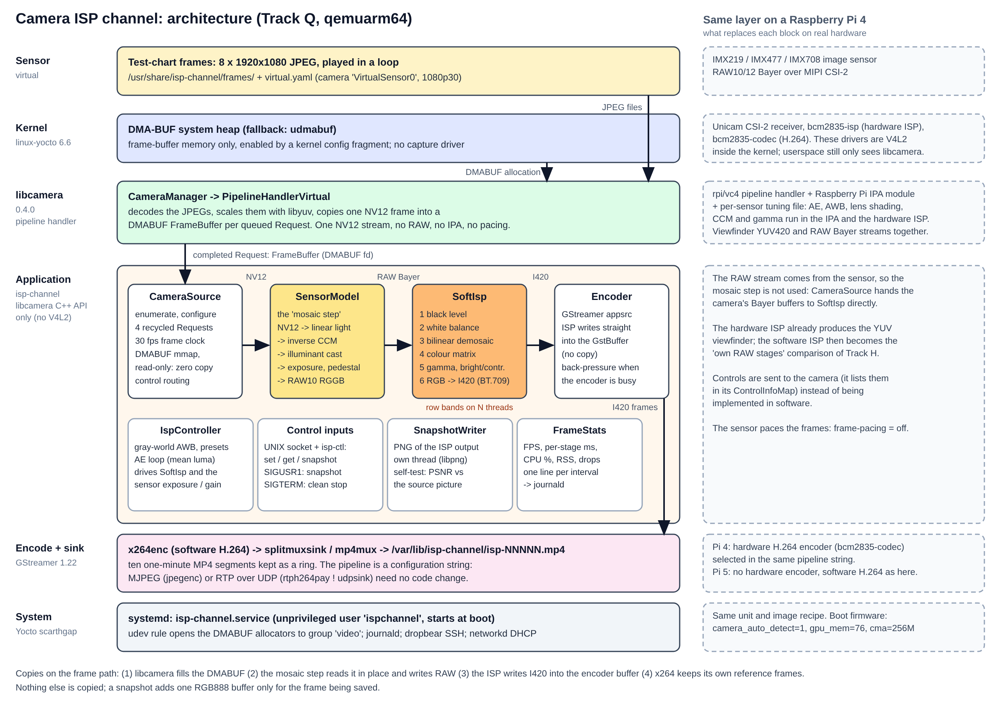

# REPORT: Camera ISP Channel on Yocto

## 1. Track and pipeline choice

**Track Q (QEMU).** I do not use any Raspberry Pi or camera hardware for this
assignment, and none was bought. Everything below was built for `qemuarm64`
and run under `qemu-system-aarch64`. The same layer also builds a Raspberry Pi
4 image (bonus, build only).

**libcamera pipeline handler: `virtual`** (libcamera 0.4.0), not `vimc`.

| | `virtual` (chosen) | `vimc` |
| --- | --- | --- |
| Where the camera lives | entirely in libcamera, userspace | kernel test driver + libcamera handler + test IPA |
| Kernel needs | a DMABUF allocator (3 config lines) | media controller, V4L2 core, vimc module |
| Output | NV12 at any size declared in YAML, 1080p here | RGB888 only, through an in-kernel debayer and scaler |
| Content | any JPEG frames: a purpose-built test chart | built-in kernel test pattern |
| Cost in QEMU | one memcpy per frame | kernel thread generates, debayers and scales every frame under emulation, at a fixed rate the app cannot control |
| RAW Bayer to the app | no | no (libcamera's vimc handler does not expose it) |

Reasons for `virtual`:

1. **The pinned release supports it.** scarthgap's meta-openembedded ships
   libcamera 0.4.0, the first release with the virtual pipeline handler. No
   libcamera version bump is needed, only enabling the handler.
2. **Neither option delivers Bayer**, so the mosaic step is needed either way.
   With `virtual` the input to that step is a picture I control, which makes
   the ISP verifiable by number (section 4).
3. **1080p NV12** is exactly the Viewfinder format the assignment asks for.
   `vimc` would give RGB888.
4. **QEMU's CPU budget goes to my code.** With `vimc` most of the emulated CPU
   would be spent in the kernel's own debayer, which is not what is being
   assessed.
5. **Less kernel surface.** No capture driver is loaded at all.

Costs of that choice, all handled in the layer: libyuv had to be packaged, the
kernel needed a DMABUF allocator, and libcamera 0.4.0 needed four upstream
fixes (section 6).

## 2. Architecture

Source: [docs/architecture.svg](docs/architecture.svg). README section 2 walks
through one frame.

Threads in the application:

| Thread | Job |
| --- | --- |
| main | the frame loop: wait for a completed request, mosaic, ISP, hand to encoder, recycle |
| ISP pool (N-1 workers + main) | one horizontal band of the frame each |
| libcamera | pipeline handler; its completion callback only enqueues the request and returns |
| signal | `sigwait()` for SIGUSR1 / SIGINT / SIGTERM; no code runs in signal context |
| control socket | accepts `isp-ctl` commands |
| snapshot | PNG compression |
| GStreamer | x264 and the muxer |

## 3. Design decisions and trade-offs

**Yocto**

- *All policy in a distro configuration.* `local.conf` is what kas generates.
  The alternative, `local_conf_header` blocks in the kas file, is quicker to
  write but is exactly the "local.conf hack" the assignment rules out.
- *Trimmed `DISTRO_FEATURES`.* A headless camera has no use for X11, Wayland
  or OpenGL. Removing them shortens the build and the image. The cost is that
  target packages cannot come from the Yocto Project's public sstate cache,
  which is built with the default features; native and cross tools still can.
- *Stock libcamera recipe plus a bbappend*, rather than a private copy of the
  recipe. Smaller diff to upstream, at the price of carrying four patches.
- *Static libyuv.* Upstream builds an unversioned `libyuv.so`. Linking the
  static archive into `libcamera.so` avoids packaging an unversioned shared
  library.
- *Unprivileged service.* The unit runs as its own user with
  `ProtectSystem=strict`. That required a udev rule for the DMABUF allocator
  nodes, which are root-only by default.
- *x264 over openh264 or MJPEG* for quality per bit. It needs the `commercial`
  licence flag, accepted for exactly two recipes. MJPEG is one configuration
  line away.

**Application**

- *libcamera C++ API directly*, not GStreamer `libcamerasrc`. The assignment
  wants request recycling, `ControlInfoMap` handling and DMABUF access to be
  visible, and `libcamerasrc` hides all three.
- *GStreamer only after the ISP*, fed by `appsrc` from memory. It gives
  encoder, muxer, file rotation and network sinks as configuration.
- *The frame clock is in the application.* The virtual pipeline handler in
  0.4.0 completes a request as soon as it is queued (frame-rate handling was
  added upstream later). Without pacing, the loop would run flat out.
- *Lossless back-pressure instead of dropping.* When the encoder or ISP is
  slower than the frame period, the next request is simply queued later. For a
  virtual sensor that is correct: no frame is ever lost and the achieved FPS is
  reported honestly. A real sensor does not wait; on hardware the same loop
  would detect the resulting gaps through the buffer sequence numbers and
  count them as drops (the code for that is in `CameraSource::describe()`).
- *Controls use libcamera's identifiers.* The same `AeEnable`, `AwbMode`,
  `Brightness`... are offered to the camera first and implemented in the
  software ISP when the camera does not list them. On QEMU that is all of
  them; on a Raspberry Pi the camera would take them.
- *Fixed-point ISP with lookup tables.* Integer arithmetic is predictable, the
  same on every CPU, and fast under emulation. Black level and white balance
  are one table per colour channel; gamma, brightness and contrast are one
  table.
- *Band threading instead of NEON* for the bonus. Thread scaling can be
  measured meaningfully in QEMU (each guest CPU is a host thread). NEON
  timings under emulation say nothing about a real core.
- *Bounded everything.* Fixed request set, fixed scratch buffers, a blocking
  `appsrc` with a two-frame limit, a ring of ten recording segments. Memory
  and disk use cannot grow with run time.

## 4. The mosaic step and the software ISP

### How Bayer is generated (assignment B2)

The virtual pipeline handler cannot supply Bayer: it has one NV12 stream and
rejects the RAW role. The application asks for `{Viewfinder, Raw}` first, sees
the refusal, and falls back to `{Viewfinder}`.

`SensorModel::capture()` then converts each NV12 frame to RAW10 RGGB. For
every pixel:

1. YUV to RGB (BT.601 full range, what a JPEG holds).
2. sRGB decode to linear light. A sensor counts photons; gamma is a display
   concept.
3. Multiply by the **inverse** of the colour correction matrix. This gives the
   sensor's own "camera RGB", which is less saturated than sRGB.
4. Divide red by 1.90 and blue by 1.60. This is the colour cast of an
   uncorrected sensor under daylight, where green is the most sensitive
   channel.
5. Scale by exposure: `(exposure time / 10 ms) x analogue gain`.
6. Scale to 10 bits, add the black-level pedestal of 64, clip at 1023.
7. Keep only the one colour that the RGGB filter passes at that pixel.

The numbers for the pedestal and the cast are typical of an IMX219. Steps 2 to
6 are done in integers with one table lookup and one three-term dot product
per pixel.

### ISP stages (assignment B4)

| # | Stage | Implementation |
| --- | --- | --- |
| 1 | Black-level correction | subtract the pedestal, clamp at zero |
| 2 | White balance | per-channel gain; gray-world or preset or manual |
| 3 | Demosaic | bilinear: average of the 2 or 4 nearest samples of each missing colour; borders mirrored |
| 4 | Colour correction | 3x3 matrix in Q10 fixed point; rows sum to 1 so grey stays grey |
| 5 | Gamma | sRGB curve; contrast pivots on mid-grey, brightness is an offset |
| 6 | Colour space | RGB to BT.709 limited-range YUV, chroma averaged 2x2 |

Stages 1 and 2 are point operations on a single sample, so they are one
1024-entry table per colour. Between stages 2 and 5 the data is 12-bit linear.

**Gray-world AWB.** Statistics are taken on the RAW frame after black level:
one 2x2 quad from every 8x8 block, skipping clipped quads. The gains are
`mean(G)/mean(R)` and `mean(G)/mean(B)`, low-pass filtered over frames.

**Auto exposure.** The mean luminance of the white-balanced statistics is
steered to 18 % by scaling exposure time first and analogue gain once the
exposure reaches one frame period. Half the error (in stops) is corrected per
frame, because a new exposure only shows in the next frame.

### How the controls drive the stages (assignment B3)

| libcamera control | Offered by the virtual camera | Effect in the software path |
| --- | --- | --- |
| `AeEnable` | no | on: AE loop sets exposure and gain. off: manual values are used |
| `ExposureTime` | no | virtual sensor exposure (mosaic step 5) |
| `AnalogueGain` | no | virtual sensor gain (mosaic step 5) |
| `AwbEnable` | no | on: gray-world or preset. off: gains are held |
| `AwbMode` | no | `auto` = gray-world; `tungsten`, `daylight`... = preset gains |
| `ColourGains` | no | manual white-balance gains |
| `Brightness` | no | gamma table offset (stage 5) |
| `Contrast` | no | gamma table slope (stage 5) |
| `FrameDurationLimits` | **yes** | sent to the camera at start |

The start-up log lists the camera's `ControlInfoMap` and prints, for each
control, whether it went to the camera or to the software ISP.

### Is the ISP correct?

Because the mosaic step is the mathematical inverse of the ISP, the output can
be compared with the input:

- Unit test `sensor + ISP round trip`: 44 dB PSNR on a smooth synthetic
  picture, for all four Bayer orders. Removing white balance, the colour
  matrix or the black-level correction each drops the PSNR by several dB,
  which shows every stage does real work.
- On the test chart: the grey steps come back within 3 code values out of 255
  and the saturated colour bars within 6. Whole-frame PSNR is about 29 dB; the
  loss is concentrated on edges and on the zone plate, which is what bilinear
  demosaic is known to do. Every snapshot logs this figure.
- Gray-world converges to gains of 1.91 and 1.61 for a simulated cast of 1.90
  and 1.60.

## 5. Frame buffers and copies (assignment B6)

libcamera's `FrameBuffer` planes are DMABUF file descriptors. In QEMU they
come from the kernel's system DMA heap (udmabuf as fallback); the start-up log
names the backing. The application maps each descriptor once with
`mmap(PROT_READ, MAP_SHARED)` and reads frames in place for the whole run.

| # | Where | Copy | Reason |
| --- | --- | --- | --- |
| 1 | libcamera, virtual handler | test frame copied into the DMABUF | there is no sensor; this is the "readout" |
| 2 | app, read of the DMABUF | none | mapped once, read in place |
| 3 | mosaic step | NV12 transformed into a RAW buffer | creates the sensor data; does not exist on hardware |
| 4 | ISP | RAW transformed into I420, written straight into the GStreamer buffer | the ISP itself; no intermediate full frame |
| 5 | app to encoder | none | buffer ownership is handed to `appsrc` |
| 6 | x264 | internal | the encoder keeps padded reference frames |
| 7 | snapshot only | one RGB888 frame | PNG needs RGB; allocated only for that frame |

What is *not* zero-copy, and why: the encoder input is system memory, not a
DMABUF, because x264 is a software encoder and needs CPU-addressable planar
data anyway. On a Raspberry Pi 4 the hardware encoder imports DMABUFs, and the
ISP output buffer would be allocated as one.

## 6. Debugging notes

**libcamera 0.4.0: garbage frame status from the virtual camera.**
*Symptom:* the first native run logged `frame 32630 completed with status
-872337728` for most frames and the application discarded them as failed.
*Root cause:* `PipelineHandlerVirtual::queueRequestDevice()` in 0.4.0 completes
buffers without ever writing `FrameMetadata`, so `status`, `sequence` and
`timestamp` are uninitialised memory. A frame was accepted only when the
garbage happened to be zero. *Fix:* upstream fixed it after the release
("pipeline: virtual: Fill buffer's metadata", in 0.5.0). That commit and the
three it depends on or completes are backported in
`recipes-multimedia/libcamera/files/` with `Upstream-Status: Backport`. I kept
the application strict about buffer status rather than papering over it there.

**libcamera would download libyuv during configure.** meta-openembedded has no
libyuv recipe, and libcamera's meson falls back to a git subproject, which
fails in BitBake's network-isolated tasks. Upstream libyuv also installs no
pkg-config file. *Fix:* a libyuv recipe at the revision libcamera pins, with a
generated `libyuv.pc`.

**"Could not open any dma-buf provider".** The virtual handler needs
`/dev/dma_heap/system` or `/dev/udmabuf`; the stock `qemuarm64` kernel has
neither. *Fix:* kernel config fragment. Then, because the service is not root,
a udev rule to give the `video` group access, and the unit orders itself after
`systemd-udev-settle.service` so the rule is applied before libcamera opens
the device.

**Demosaic read out of bounds.** AddressSanitizer in the unit tests caught
`cur[x - 1]` with an unsigned `x` of zero: the index wrapped to 4 GiB instead
of reaching the padding sample. *Fix:* signed loop index. The unit tests run
under ASan and UBSan in CI.

**Unthrottled frame rate.** The virtual handler ignores `FrameDurationLimits`
in 0.4.0. Found by reading its source before writing the loop; handled by the
application's frame clock.

**Round-trip PSNR looked too low on the first chart** (24 dB). Per-region
analysis showed flat patches were within 2 code values and the entire error
sat in the zone plate, which reached the Nyquist frequency. That is a property
of Bayer sampling, not a bug; the zone plate now stops at half Nyquist.

## 7. Measurements

### 7.1 Target: QEMU `qemuarm64`, 10-minute soak

Full output: [docs/evidence/qemu/measurements.md](docs/evidence/qemu/measurements.md).
Raw logs: `boot.log` (serial console), `journal-boot.log`, `journal-isp-channel.log`.
Guest: `-machine virt -cpu cortex-a57 -smp 4 -m 1024`, TCG on a 4-CPU x86-64 host.

| Measurement | Result |
| --- | --- |
| Boot to login prompt | 22 s wall clock; systemd reports 1.99 s kernel + 11.70 s userspace |
| Streaming time, frames | 661 s, 3826 frames |
| **FPS, Viewfinder stream** (libcamera NV12 1920x1080) | 5.79 average |
| **FPS, RAW stream** (mosaic step, RGGB 10-bit 1920x1080) | 5.79, one RAW frame per Viewfinder frame |
| **FPS, encoded stream** (H.264 1920x1080) | 5.79, every frame encoded |
| FPS per 10 s interval | min 4.14, mean 5.81, max 6.55 |
| Dropped frames | **0** |
| Failed or cancelled requests | **0** |
| Per-frame time: virtual sensor (mosaic) | 77.2 ms |
| Per-frame time: software ISP (statistics + 6 stages) | 93.8 ms |
| Per-frame time: encoder hand-off | 2.7 ms |
| Per-frame time: total | 174.0 ms average, 456.3 ms worst |
| CPU, `isp-channel` process | 356 % of 400 % |
| Memory, RSS after warm-up | 143.8 to 150.8 MiB, no trend |
| ISP round trip (snapshot self-test) | 28.6 dB PSNR against the source picture |
| Recording ring | 10 segments on disk, older ones rotated out |

Reading the numbers:

- **Stable, not fast.** Target 30 fps, achieved about 6. The frame loop is CPU
  bound under emulation: all four guest cores are busy (356 %), shared between
  the ISP threads and x264. The frame clock stretched; nothing was dropped.
- **No memory growth.** RSS moves inside a 7 MiB band for 11 minutes with no
  upward trend; the table in `measurements.md` has it at 50 s steps.
- **FPS dips to about 4.5** line up with host scheduling stalls, not with the
  application: the guest kernel logged `hrtimer: interrupt took 11 ms` in the
  same window. The build machine is itself a shared VM.
- The virtual sensor costs nearly as much as the ISP. It does comparable
  per-pixel work (colour conversion, a table lookup, a dot product) and it does
  not exist on real hardware.

### 7.2 Multithreading gain (bonus B8)

`isp-bench`, 1920x1080, service stopped so the benchmark has the CPUs to itself.

| Threads | QEMU guest: ISP ms | Speed-up | x86-64 host: ISP ms | Speed-up |
| --- | --- | --- | --- | --- |
| 1 | 165.5 | 1.00x | 16.8 | 1.00x |
| 2 | 86.8 | 1.91x | 10.6 | 1.59x |
| 4 | 44.9 | **3.69x** | 6.7 | **2.50x** |

The guest scales almost linearly because each guest CPU is a host thread and
the workload is integer arithmetic over independent row bands. The host
figure is lower because its 4 CPUs are 2 cores with hyper-threading and the
single-thread run is already limited by memory bandwidth. Output is
bit-identical for every thread count (`testThreadInvariance`).

In the running service the ISP takes 94 ms, not 45 ms, because x264 competes
for the same four cores.

### 7.3 x86-64 build host, for reference only

The same application built for the x86-64 build machine (4 CPUs, Xeon
2.1 GHz), running against the same virtual camera for 10 minutes. This shows
what the frame loop does when the CPU is not emulated. It is not an ARM
measurement.

| Measurement | Result |
| --- | --- |
| Frames | 17 996 in 600.3 s |
| FPS | 29.98 average; 29.77 to 30.00 per 30 s interval |
| Dropped / failed | 0 / 0 |
| Per frame | virtual sensor 4.1 ms, ISP 6.7 ms, total 10.8 ms, worst 76 ms |
| CPU | 127 % of 400 % |
| Memory (RSS) | 168.7 to 169.1 MiB over the whole run |

Log: [docs/evidence/native/soak-x86_64.log](docs/evidence/native/soak-x86_64.log).
The build machine has no `/dev/udmabuf`, so for this one run libcamera's buffer
allocator was patched locally to hand out plain memfds; the CI run on GitHub
and the QEMU image use real DMABUFs. The whole application was also run under
AddressSanitizer and LeakSanitizer on this machine with no findings.

### 7.4 Continuous integration

Every push runs, on a GitHub-hosted runner: the no-V4L2 grep, the unit tests
under AddressSanitizer and UndefinedBehaviorSanitizer, and the full
application against libcamera 0.4.0 (with the layer's patches) using the
runner's real `/dev/udmabuf`. The end-to-end job checks frame counts, both
snapshot triggers, a run-time control change and the round-trip PSNR.

## 8. QEMU timings do not represent a real board

QEMU emulates every ARM instruction in software (TCG); there is no KVM for an
aarch64 guest on an x86 host. The guest is tens of times slower than a real
Cortex-A72, the slowdown is not uniform across integer, memory and SIMD work,
and it depends on the host and its load. So:

- Absolute milliseconds and FPS in section 7 say nothing about a Raspberry Pi.
- What does carry over: stability over time, zero drops, flat memory, the
  relative cost of the stages, and the shape of the thread scaling.
- The native numbers in section 7 are from an x86-64 build machine and show
  that the code reaches 30 fps at 1080p on ordinary hardware. They are not ARM
  numbers either.

## 9. What changes on a real Raspberry Pi

| Area | QEMU (this submission) | Raspberry Pi 4 |
| --- | --- | --- |
| Sensor | JPEG frames from a YAML-defined virtual camera | IMX219/IMX477/IMX708, enabled by `camera_auto_detect=1` or a `dtoverlay` |
| CSI receiver | none | Unicam (Pi 4) or CFE/RP1 (Pi 5), kernel driver |
| Pipeline handler | `virtual` | `rpi/vc4` (Pi 4), `rpi/pisp` (Pi 5); set by `LIBCAMERA_PIPELINES` |
| IPA and tuning | none | Raspberry Pi IPA module with a per-sensor JSON tuning file: AGC/AEC, AWB, lens shading, CCM, gamma, denoise |
| ISP | software, in the application | hardware: `bcm2835-isp` (Pi 4) or PiSP back end (Pi 5), driven by libcamera |
| Streams | one NV12 stream | Viewfinder YUV420 and full-sensor RAW Bayer together |
| RAW input to my ISP | synthesised by the mosaic step | the camera's RAW stream; the mosaic step is unused |
| Controls | all implemented in software | sent to the camera, which lists them in its `ControlInfoMap` |
| Frame timing | application frame clock | the sensor; `frame-pacing = off` |
| Frame buffers | DMA heap / udmabuf | CMA-backed DMABUFs; hence `cma=256M` |
| Encoder | x264 software | Pi 4: hardware H.264 (`bcm2835-codec`), a change to the `pipeline` string. Pi 5: no hardware encoder, software stays |
| Latency | not meaningful | measurable end to end; needs a real sensor timestamp |
| Memory tuning | `-m 1024` | `gpu_mem=76`, `cma=256M` |

What I would verify first on hardware: the RAW formats the pipeline handler
offers (the application accepts unpacked 10- and 12-bit Bayer), the black
level from the sensor metadata instead of a constant, and the software ISP
output against the hardware ISP's on the same RAW frame.

## 10. Assumptions

- "Largest mode the source supports" is 1920x1080, which is what the virtual
  camera is declared with; 30 fps is the target, not the achieved rate in QEMU.
- A snapshot is the ISP output as PNG. A DNG of the RAW frame was not
  required ("PNG or DNG") and is not implemented.
- "No dropped frames" for a virtual sensor means every queued request
  completes successfully and every completed frame is encoded. Both are
  counted and checked.
- The grep for V4L2 is over the application source. The layer's distro
  configuration mentions the GStreamer "video4linux" plugin once, to say it is
  not built.
- The Raspberry Pi image is a build target only, as the bonus item allows.

## 11. Limitations

- Nothing here has run on Raspberry Pi hardware. Section 9 is from the
  libcamera and meta-raspberrypi sources, not from measurement.
- The camera-RAW input path and the Raspberry Pi configuration file are
  compiled but untested.
- The ISP has no lens shading, denoise, sharpening or defect correction, and
  the demosaic is the simplest one.
- AE and AWB are global, single-zone algorithms.
- The image has a passwordless root login.

## 12. Use of AI tools

AI assistance (Claude Code) was used, as the assignment permits; the commits
carry a `Co-Authored-By` trailer. `docs/code-walkthrough.md` explains the
application file by file.
